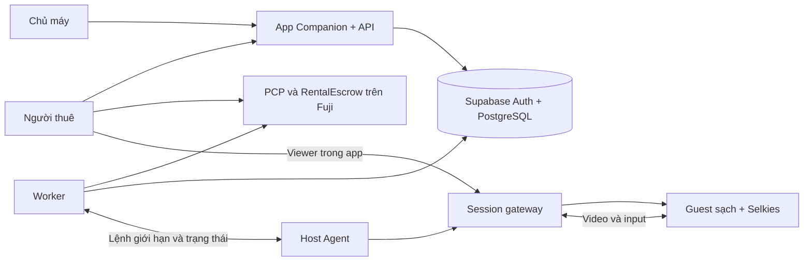

# Cloud PC Companion

**Chợ thuê PC từ xa với thanh toán minh bạch trên Avalanche.** Chủ máy cho thuê PC nhàn rỗi theo khung giờ. Người thuê trả bằng PCP (token thử) qua hợp đồng escrow trên Avalanche Fuji, rồi dùng desktop từ xa ngay trong ứng dụng Windows.

`Avalanche Fuji (chainId 43113)` · `Tauri 2 + React 19` · `Supabase` · `Solidity 0.8.28` · `704 test tự động` · `Chỉ testnet`

> **English summary.** Cloud PC Companion is a peer-to-peer marketplace for renting idle Windows PCs. A host shares a clean Selkies/Linux guest running in WSL2; a renter pays in a restricted test token (PCP) through an EIP-712-quoted escrow on **Avalanche Fuji (chain 43113)** and streams the desktop inside a Tauri app. Everything runs on testnet only. The contracts can be verified on the explorer (section 3), the 704 automated tests run without any credentials (section 7A), and a live demo is available on request (section 7B). Section 6 states what has and has not been verified.

## Mục lục

1. [Tổng quan](#1-tổng-quan)
2. [Cách hoạt động](#2-cách-hoạt-động)
3. [Tích hợp Avalanche Fuji](#3-tích-hợp-avalanche-fuji)
4. [Kiến trúc và cấu trúc repo](#4-kiến-trúc-và-cấu-trúc-repo)
5. [Bảo mật và mô hình tin cậy](#5-bảo-mật-và-mô-hình-tin-cậy)
6. [Trạng thái xác minh và giới hạn](#6-trạng-thái-xác-minh-và-giới-hạn)
7. [Bắt đầu](#7-bắt-đầu) (A: xem mã và giao diện, B: dùng thử bản demo, C: tự dựng, D: màn Quản trị)
8. [Tài liệu](#8-tài-liệu)
9. [Giấy phép](#9-giấy-phép)

## 1. Tổng quan

**Vấn đề.** Nhiều máy tính cấu hình cao nằm không phần lớn thời gian, trong khi người khác chỉ cần sức mạnh đó trong vài giờ. Giữa hai bên thiếu một nơi để thỏa thuận giá, giữ chỗ, thanh toán và hoàn tiền mà không phải tin vào lời hứa của nhau.

**Giải pháp.** Cloud PC Companion kết nối hai bên bằng một ứng dụng Windows duy nhất:

- Chủ máy đăng máy, đặt khung giờ và bật nhận thuê. Cấu hình máy do ứng dụng tự đọc, không tự khai.
- Người thuê chọn máy, giữ chỗ và trả tiền. Tiền nằm trong hợp đồng escrow và được chia theo quy tắc cố định khi phiên kết thúc.
- Phiên thuê chạy trong một môi trường Linux sạch dựng riêng cho từng phiên; hình ảnh và thao tác đi qua session gateway của chủ máy ngay trong ứng dụng.

**Điểm nổi bật**

- **Thanh toán on-chain.** Quote EIP-712 do server ký, `fund` / `activate` / `accept` trên `RentalEscrow`, hoàn tiền và rút tiền theo kiểu pull-payment, `pause` không chặn đường rút tiền.
- **Desktop từ xa trong ứng dụng.** Host-agent cấp token xem dùng một lần; Selkies không mở trực tiếp cho người thuê.
- **Máy sạch cho mỗi phiên.** Sau phiên, quyền xem bị thu hồi, container bị xóa và dựng lại, máy chỉ được nhả khi xác minh sạch.
- **Chủ máy tự phục vụ.** Đăng ký, đăng máy sau khi quét đạt điều kiện và ghi danh thiết bị đều làm ngay trong ứng dụng, không cần quản trị viên duyệt.
- **Trạng thái online do máy chủ đo.** Máy chuyển sang offline trong vài giây khi chủ máy dừng nhận thuê, đăng xuất hoặc thoát ứng dụng. Trang Khám phá ẩn máy offline theo mặc định và tự làm mới mỗi 10 giây.
- **Ví thử riêng cho từng tài khoản.** Ứng dụng tự sinh ví Fuji cho mỗi tài khoản; vòi PCP và AVAX gas hoạt động phía máy chủ.
- **Cấu hình fail-closed.** Thiếu hoặc sai cấu hình thì ứng dụng báo lỗi, không rơi về dữ liệu mẫu.

PCP là token thử, không có giá trị tiền, không mua bán hay đổi ra VND. AVAX chỉ dùng để trả gas.

## 2. Cách hoạt động

Ứng dụng Companion (Tauri 2 + React) có hai chế độ trong cùng một tài khoản:

| Vai trò | Chức năng |
| --- | --- |
| **Người thuê** | Tìm máy, giữ máy, trả PCP, mở màn hình máy thuê, kết thúc phiên, rút tiền hoàn về ví |
| **Chủ máy (host)** | Đăng máy (chỉ đặt tên và mô tả; CPU, GPU, RAM, ổ đĩa do ứng dụng tự đọc, RAM/CPU chia sẻ cho khách do chủ máy chọn) và khung giờ, cài môi trường Linux trong WSL2 qua ứng dụng, ghi danh thiết bị, bật/dừng nhận thuê, xem thu nhập |
| **Quản trị** | Vai trò giám sát, không phải cổng duyệt: xem host, máy, phiên và nhật ký; đình chỉ hoặc khôi phục máy và host; thu hồi thiết bị; xóa máy chưa có tiền hoặc phiên. Màn **Quản trị** chỉ hiện với tài khoản có role admin ở chế độ thật |

Một PC phục vụ một máy tại một thời điểm: nếu đổi sang tài khoản khác trên cùng PC, ứng dụng yêu cầu ghi danh lại cho máy của tài khoản đó trước khi nhận thuê.

**Luồng một phiên thuê**

1. Đăng nhập (Supabase Auth) và liên kết ví bằng chữ ký.
2. **Giữ máy:** cơ sở dữ liệu giữ chỗ nguyên tử (một booking sống cho mỗi máy), server ký quote EIP-712.
3. **Trả tiền:** `approve` + `fund` PCP vào `RentalEscrow` trên Fuji; server đối soát receipt trên chuỗi.
4. Worker yêu cầu guest chuẩn bị máy sạch (container Selkies), sau đó operator gọi `activate` trên chuỗi.
5. Host-agent cấp token xem một lần; ứng dụng đổi token lấy phiên và hiển thị desktop Linux qua session gateway của host.
6. **Kết thúc:** `accept`, escrow chia tiền (phí nền tảng 10%, host nhận phần còn lại).
7. Thu hồi quyền xem, xóa và dựng lại container, xác minh sạch, rồi nhả máy.

**Quy tắc tiền** (theo hợp đồng): gói demo 15 phút. Kết thúc sớm sau khi kích hoạt vẫn trả cả gói. Hủy trước khi kích hoạt được hoàn đủ; khoản hoàn được **ghi có trong escrow** và người thuê tự **Rút về ví** (pull-payment).

## 3. Tích hợp Avalanche Fuji

Chain **Avalanche Fuji C-Chain, chainId 43113**. Triển khai ngày 17/11/2026, khối `61220946`. Địa chỉ cũng nằm trong `contracts/deployments/fuji.json` (dữ liệu công khai).

| Hợp đồng | Địa chỉ |
| --- | --- |
| **PCP** (ERC-20 hạn chế) | [`0x9040f984ea24661d8e57f140b4ce96dac6af513e`](https://testnet.snowtrace.io/address/0x9040f984ea24661d8e57f140b4ce96dac6af513e) |
| **RentalEscrow** | [`0x280697a0ba53aeea1b1cb3c15eb2c04461a243e1`](https://testnet.snowtrace.io/address/0x280697a0ba53aeea1b1cb3c15eb2c04461a243e1) |
| Giao dịch cấu hình escrow (`configureEscrowOnce`) | [`0x0f50f7fd…5a5280`](https://testnet.snowtrace.io/tx/0x0f50f7fdc48e8ed092de94d4cc31ac31a777ce28e8c59b46d66c429efd5a5280) |

Vai trò on-chain (địa chỉ công khai): admin `0x5ea46bed5249ea11edaa4bbc389854870a76d6a2`, operator `0x384D38BD2d656B714460BAA0180C11d54af10D46`, arbitrator `0xfE2852313c41875FFB59f067565F0911AF7b4cEc`, quote signer `0xD2D0e33b7bcd8a190B9E4afC925cdc4b05560D24`, issuer `0x4BFfeB1Cb1B9FB25Ae9e0a4747D33Bc319684012`, treasury `0x8f006D933EF8670569fBF8E6398446eF671b9ace`.

Cấu hình: `feeBps = 1000` (10%), `durationSeconds = 900`, `graceSeconds = 600`, `arbitrationSeconds = 86400`. Biên dịch bằng solc 0.8.28, optimizer 200 runs, `viaIR`. Domain EIP-712: `CloudPCRentalEscrow` v1.

**Kiểm chứng.** Mở trang địa chỉ RentalEscrow ở trên để xem danh sách giao dịch và log (`Funded`, `Activated`, accept/settle, rút tiền). Mã nguồn: `contracts/contracts/PCP.sol` và `RentalEscrow.sol`; ABI: `packages/shared/src/abi/`.

**Biên nhận mẫu trên Fuji** (đọc từ log hợp đồng ngày 20/11/2026; một chu trình đầy đủ với giá 20 PCP, phí 10% = 2 PCP, host nhận 18 PCP):

| Bước | Giao dịch trên Snowtrace |
| --- | --- |
| Nạp PCP vào escrow (`fund`) | [`0x2eb3b6fa…b2fb5a`](https://testnet.snowtrace.io/tx/0x2eb3b6fa99a4621c59f6080f08a8e2100e54d574ea35a2bd225891b730b2fb5a) |
| Kích hoạt phiên (`activate`) | [`0xc6cc84a2…68cc60`](https://testnet.snowtrace.io/tx/0xc6cc84a2406d22372892e32915dab90626da970015b694086b1736e69f68cc60) |
| Kết thúc và chia tiền (`accept`) | [`0xc89b90c5…87c8f7`](https://testnet.snowtrace.io/tx/0xc89b90c5b81f40cfc817a0cbdfabcb5110712c79f60e26e4a4049b284287c8f7) |
| Hoàn tiền cho người thuê (hủy trước khi kích hoạt) | [`0x40eec114…605a8c`](https://testnet.snowtrace.io/tx/0x40eec1147ae6648b9335ee144664aa094ba7c5d4df33ef40cfc142218c605a8c) |
| Rút tiền về ví (`withdrawPCP`): host rút 55,56 PCP khoản chia tiền | [`0x4f5f18de…a09bfb`](https://testnet.snowtrace.io/tx/0x4f5f18de0511b10334775689cb6516ec600b845cacfd5875ed7f7e920ba09bfb) |

Tổng trong log (đọc ngày 20/11/2026): 7 lần `Funded`, 6 `Activated`, 6 `Settled`, 1 `Refunded`, 1 `CreditWithdrawn`, 0 tranh chấp. Tự đọc lại số liệu (chỉ đọc, không cần khóa): `node scripts/fuji/receipts.mjs --md`, và `node scripts/fuji/activity.mjs` cho số dư tổng hợp.

**Ghi chú về giao dịch rút tiền.** `withdrawPCP` được gọi bằng đúng hàm ví của ứng dụng (`withdraw` trong `desktop/src/api/devWallet.ts`, cùng hàm mà nút **Rút về ví** gọi), bởi ví host thử, qua một script chạy ngày 20/11/2026, không bấm qua giao diện. Kết quả: credit chờ rút 55,555555055555555505 PCP về 0 và số dư PCP của ví tăng đúng bằng số đó (chênh lệch 0). Một số khoản credit khác vẫn nằm trong escrow chờ chủ ví rút; trong đó 12,35 PCP của một ví tạm cũ không còn rút được vì khóa ví đó chỉ tồn tại trong bộ nhớ lúc chạy thử.

**Thiết kế hợp đồng**

- **PCP:** ERC-20 18 decimals, trần 1.000.000, **chỉ chuyển qua escrow** (không chuyển P2P, không permit/burn/mint tự do). Vòi: 1.000 PCP một lần cho mỗi ví. `configureEscrowOnce` chỉ gọi được một lần.
- **RentalEscrow:** quote EIP-712 16 trường; `fund` kéo token trong cùng giao dịch và kiểm số nhận chính xác (chặn fee-on-transfer); các hàm cancel / refund / activate / accept / dispute / claim / resolve / `withdrawPCP`. Pull-payment, `pause` chỉ chặn `fund` và `activate` (tiền vẫn thoát được), **không có sweep**.
- **Kiểm thử:** 52 test Hardhat (sai quote/asset/domain/thời gian, biên thời gian đúng một giây, race cancel↔activate và dispute↔claim, làm tròn phí, reentrancy, fee-on-transfer). Chưa audit độc lập, chưa fuzz/invariant.

## 4. Kiến trúc và cấu trúc repo



**Hai đường riêng.** *Control plane* quản lý đăng nhập, booking, tiền và quyền. *Streaming plane* truyền hình và input giữa ứng dụng và guest qua gateway; Selkies không mở trực tiếp cho người thuê. Blockchain không xử lý khung hình, tệp hay dữ liệu cá nhân.

**Nguồn sự thật.** Tiền do hợp đồng quyết định; danh tính và giữ chỗ do cơ sở dữ liệu; trạng thái guest do bằng chứng từ agent (trạng thái không rõ **không** được coi là thành công); máy chỉ nhả khi tiền ở trạng thái cuối và dọn dẹp đạt.

| Thư mục | Nội dung |
| --- | --- |
| `desktop/` | Ứng dụng Companion (React 19, Vite, Tailwind 4); `desktop/src-tauri/` là vỏ native Rust (Tauri 2, 10 lệnh native cố định cho chế độ Cho thuê) |
| `server/` | API core, worker (lease, fencing, đối soát chuỗi), workspace broker |
| `web/` | Next.js: route `/api/[...path]` (adapter mỏng gọi `server/`) và trang giới thiệu |
| `host-agent/` | Agent chạy trong guest Linux, session gateway (token một lần, thu hồi, watchdog), script guest |
| `contracts/` | `PCP.sol`, `RentalEscrow.sol`, test Hardhat 3 + viem, script triển khai |
| `db/` | Test migration/RLS/đồng thời (PGlite và PostgreSQL thật) |
| `supabase/` | 11 migration, script kiểm sau khi áp dụng |
| `packages/shared/` | Schema zod, tiền PCP, lọc máy, ABI xuất ra `src/abi/` |
| `scripts/` | `fuji/` (khóa, nạp, triển khai, kiểm), `public/` (tunnel, quản trị, `start-all.ps1`), `vm/` (dựng demo, build bộ cài, e2e) |
| `docs/`, `specs/` | Hồ sơ đặc tả, runbook, nhật ký tiến độ (Spec Kit) |
| `design-preview/` | Bản mẫu giao diện tĩnh, chỉ để tham khảo |

Công nghệ: TypeScript 6, Node, React 19, Vite 8, Tailwind 4, Tauri 2, Next 16, Supabase (Postgres + RLS), Solidity 0.8.28 + OpenZeppelin 5, Hardhat 3, viem, Selkies, Cloudflare Tunnel.

## 5. Bảo mật và mô hình tin cậy

- **Host là bên được tin.** Chủ máy là quản trị viên của PC nên không thể bảo vệ dữ liệu của khách khỏi chính mình; WSL2 và Docker không phải chứng nhận cô lập. Chỉ nên cho thuê giữa các bên tin nhau và không đặt dữ liệu quan trọng trong máy thuê.
- **Agent chỉ gọi ra ngoài**, không mở cổng vào từ Internet, không có đường chạy lệnh tùy ý: 10 lệnh native cố định, tham số được kiểm dạng ở cả Rust và script guest, cấu hình và mã ghi danh đi qua stdin.
- **Gateway:** nghe loopback trong guest; token xem dùng một lần và đổi lấy phiên; không có token thì trả 401; thu hồi khi phiên kết thúc.
- **Dữ liệu:** RLS mặc định từ chối; client không ghi được booking, outbox, role; hàm chỉ dành cho server được cấp riêng cho `service_role`; test quét mọi hàm trong schema `public`.
- **Cấu hình fail-closed:** thiếu hoặc sai cấu hình thì ứng dụng báo lỗi, API trả 503 và nêu tên biến. Server từ chối khóa Hardhat công khai đi kèm RPC từ xa; ứng dụng từ chối key `sb_secret_…` trong `VITE_*`.
- **Ví thử:** khóa lưu trong `localStorage` của WebView theo từng tài khoản, chỉ dùng cho testnet. Đây không phải ranh giới bảo mật giữa những người dùng chung một hồ sơ Windows.
- **Bản thử công khai:** proxy chỉ chuyển `/api/*` và chặn `/api/admin/*` từ Internet. Cloudflare Quick Tunnel là dịch vụ không cam kết và là bên trung gian có thể thấy lưu lượng của phiên (hình ảnh và thao tác). Máy chủ demo chạy trên PC của nhóm phát triển nên tắt máy là dịch vụ dừng. Chi tiết: [SECURITY](docs/SECURITY.md).
- **Chưa audit độc lập**, bộ cài chưa ký số.
- File `.env*` thật nằm ngoài Git (chỉ `*.example` được commit). Các khóa `0x…` xuất hiện trong test và script demo là khóa công khai của Hardhat, vô giá trị với chuỗi thật.

## 6. Trạng thái xác minh và giới hạn

Phần này ghi rõ điều đã được kiểm chứng và điều chưa, để người đánh giá biết chính xác mức độ hoàn thiện.

**Vòng thuê đầy đủ** (giữ máy → trả tiền → kích hoạt → xem desktop → kết thúc → chia tiền → máy sạch lại) đã chạy thật trên Fuji, nhưng **trên một máy**: người thuê và host cùng mạng, đi qua tunnel công khai. Chưa có người ở máy khác mạng thuê thử và chưa đo hiệu năng.

| Phần | Trạng thái |
| --- | --- |
| Đăng ký, đăng nhập, danh mục máy, giữ máy (Supabase dev) | Chạy thật |
| Chủ máy tự đăng ký, tự đăng máy sau khi quét đạt, thông số máy do ứng dụng tự đọc, màn Quản trị | Có trong ứng dụng. Thông số máy mới kiểm bằng dữ liệu giả, test và một lần chạy trên máy phát triển; màn Quản trị đã kiểm trong trình duyệt với dữ liệu thật |
| Ví thử trong ứng dụng, vòi PCP và gas trên Fuji | Chạy thật bằng script dùng chính mã của ứng dụng; ví riêng theo tài khoản đã kiểm trong ứng dụng cài đặt |
| Thanh toán, kích hoạt, kết thúc, chia tiền trên escrow Fuji | Chạy thật trên một máy: 20/20 bước đạt qua tunnel công khai (18/11), số tiền và phí 10% khớp chính xác (so với giá tính bằng bigint) |
| Xem màn hình qua gateway của host | Trình duyệt thật đổi token một lần (HTTP 200), WebSocket nhận luồng hình 1280×720; không token bị từ chối (401) |
| Host WSL2 + Docker + image Selkies | Chạy thật trên máy phát triển: agent ghi danh, nhận lệnh, chạy trọn một phiên |
| Trạng thái online | Đã đo trên hệ thống thật: sau khi dừng agent, máy chuyển `online` → `offline` trên danh mục công khai sau 1,7 giây. Agent bị tắt cứng hoặc mất điện thì máy offline sau tối đa 90 giây (hết hạn heartbeat) |

**Chưa kiểm chứng**

- Hai máy ở hai mạng khác nhau, độ trễ và FPS: **chưa đo, không có tuyên bố hiệu năng nào**.
- Viewer nhúng trong WebView2 (chuột, bàn phím, âm thanh, toàn màn hình).
- Nút **Rút về ví** bấm qua giao diện (hàm rút của ví ứng dụng đã chạy thật trên Fuji bằng script, xem mục 3).
- Bộ cài trên máy khác (chưa ký số: SmartScreen cảnh báo, Smart App Control chặn hẳn).
- GPU/NVENC trong WSL2; chỉ đọc được tên GPU NVIDIA (GPU AMD/Intel hiện ghi "chưa đọc được tên").
- Script `scripts/browser-check-live.mjs` còn so khớp lời giao diện cũ nên chưa đạt (không thuộc `npm test`).

**Còn mô phỏng hoặc chưa làm:** workspace dùng thư mục cục bộ (`LocalFsStore`), chưa dùng S3; thông báo, hỗ trợ, trọng tài, thu nhập chi tiết; AI tư vấn và host bond mới có thiết kế; audit hợp đồng; triển khai web công khai.

Chi tiết và nhật ký: [PROGRESS](docs/PROGRESS.md), [HOST_WINDOWS_WSL](docs/HOST_WINDOWS_WSL.md), [DEMO_RUNBOOK](docs/DEMO_RUNBOOK.md), [TESTER_GUIDE](docs/TESTER_GUIDE.md).

## 7. Bắt đầu

| Mức | Cần gì | Kết quả |
| --- | --- | --- |
| **A** | Node.js, không cần tài khoản | Giao diện ứng dụng với dữ liệu mẫu có nhãn; 704 test tự động |
| **B** | Bộ cài và liên kết kết nối do nhóm cấp | Vòng thuê thật trên Fuji với máy của nhóm |
| **C** | Hạ tầng riêng (Supabase, AVAX Fuji, Windows 11 + WSL2) | Tự dựng toàn bộ hệ thống |

### A. Xem mã và giao diện (không cần tài khoản)

Yêu cầu: **Node.js ≥ 20.9** (đã chạy với Node 26, npm 11) và Git. Đã chạy trên Windows 11; macOS và Linux chưa được thử.

```bash
git clone https://github.com/nguyenkhoi152/cloud-pc-marketplace.git
cd cloud-pc-marketplace
npm install
```

**Xem giao diện** (chế độ preview, toàn bộ dữ liệu là mẫu có nhãn):

```bash
npm run dev:desktop        # mở http://127.0.0.1:5174
```

Không có file `.env` thì ứng dụng tự vào chế độ preview. Mở `/#/welcome`, chọn "Vào nhanh với tài khoản demo", rồi chọn chế độ Thuê máy hoặc Cho thuê máy. Nút **Demo** ở thanh trên đổi kịch bản (thành công, lỗi dịch vụ, mất mạng, host chưa duyệt, lỗi cleanup…). Ở preview mọi hành động liên quan tiền và remote chỉ là mô phỏng.

**Chạy toàn bộ test:**

```bash
npm test
```

Bộ kiểm tra (`npm ci`, `npm run typecheck`, `npm run lint`, `npm test`) đã được chạy từ một bản clone sạch của repo trên Windows 11 và đều exit 0.

| Workspace | Test | Kiểm gì |
| --- | --- | --- |
| `packages/shared` | 28 | Schema, tiền PCP (chuỗi thập phân, bigint, không dùng number), lọc máy, cấu hình |
| `db` | 87 | Migration, RLS, grants, khóa đồng thời, tự đăng máy, màn Quản trị. Chạy trên PGlite **và PostgreSQL 18 thật** cục bộ, hai connection |
| `contracts` | 52 | PCP và RentalEscrow trên mạng Hardhat |
| `desktop` | 370 | Logic domain, lớp API live (client giả có nhãn), render từng màn, bàn phím, liên kết kết nối, thẻ máy, màn Giới thiệu (đối chiếu lời với cấu hình hợp đồng trên Fuji), đọc thông số máy, ví theo tài khoản, đăng xuất và trạng thái online |
| `host-agent` | 58 | Agent, enrollment, session gateway, báo offline khi dừng |
| `server` | 109 | API, worker, đối soát chuỗi; gồm một bài tích hợp E2E cục bộ (HTTP thật + worker + agent + gateway + Postgres thật) |

Lần chạy đầu cần Internet để Hardhat tải trình biên dịch solc 0.8.28; PostgreSQL 18 cho test `db` đi kèm devDependency `embedded-postgres` nên đã có sau `npm install`. Bài E2E dùng chuỗi, guest/Selkies và operator **giả có nhãn**, không chạm Fuji.

Lệnh riêng lẻ: `npm run typecheck`, `npm run lint`, `npm run build:desktop`, `npm test -w @cpm/contracts`, `npm run compile -w @cpm/contracts`. Test Rust của lớp native cần Rust và phải **dựng agent trước** (vì `host-agent/dist/` không nằm trong Git mà `host.rs` nhúng tệp từ đó lúc biên dịch): `npm run bundle:agent -w @cpm/desktop`, rồi `cargo test --release --lib` trong `desktop/src-tauri`.

**Biên dịch và triển khai contract cục bộ** (không cần ví, không tốn gì): `cd contracts && npx hardhat run scripts/deploy.ts` triển khai lên mạng mô phỏng trong tiến trình và ghi manifest cục bộ.

### B. Dùng thử bản demo

Máy chủ API, worker và máy cho thuê của bản demo chạy trên PC của nhóm phát triển, nên chỉ dùng được khi nhóm đang bật; địa chỉ tunnel Cloudflare đổi mỗi lần khởi động lại. Liên hệ nhóm để hẹn giờ thử và nhận liên kết kết nối.

1. Cài `Cloud PC Companion_0.2.11_x64-setup.exe` (Windows 11), tải ở mục **Releases** của repo, kèm `SHA256SUMS.txt`. Bộ cài **chưa ký số** (`Get-AuthenticodeSignature` báo `NotSigned`), nên tùy máy sẽ gặp một trong hai trường hợp:
   - **SmartScreen** ("Windows protected your PC"): đối chiếu SHA-256 trong `SHA256SUMS.txt` bằng `Get-FileHash <tệp> -Algorithm SHA256`, rồi chọn *More info → Run anyway*.
   - **Smart App Control** (thường bật sẵn trên Windows 11 mới cài): **chặn hẳn, không có nút bỏ qua và không cho phép riêng từng ứng dụng**. Chỉ có cách tắt trong *Windows Security → App & browser control → Smart App Control settings → Off*. Trên bản Windows cũ, đã tắt thì không bật lại được nếu không cài lại Windows (bản mới hơn có thể bật lại). Nếu không muốn tắt, dùng máy khác hoặc xem mức A.
2. Bấm **liên kết kết nối** do nhóm cấp (`https://….trycloudflare.com/api/connect`), chọn *Mở*, rồi **Kết nối** ở hộp xác nhận. Nếu không được, dán địa chỉ vào **Cài đặt → Kết nối máy chủ**. Chỉ dán địa chỉ từ nguồn đáng tin: ứng dụng gửi phiên đăng nhập tới địa chỉ đó.
3. **Đăng ký tài khoản mới** (dùng email và mật khẩu không trùng tài khoản quan trọng). Không dùng tài khoản của host: hệ thống chặn host thuê máy của chính mình.
4. **Ví → Liên kết ví → Nhận PCP và AVAX.** Ứng dụng tự sinh một ví thử riêng cho tài khoản (khóa lưu trong ứng dụng; xóa dữ liệu ứng dụng là mất ví, không ảnh hưởng vì là testnet).
5. **Khám phá → chọn máy → Giữ máy → Trả tiền.** Chờ các bước chuẩn bị (thường 1,5 đến 3 phút), rồi **Mở màn hình**. Máy đang offline bị ẩn mặc định; tích **Hiện cả máy đang offline** để xem tất cả.
6. **Kết thúc phiên.** Dữ liệu trong máy thuê bị xóa khi phiên kết thúc.
7. Thử hoàn tiền: giữ máy, trả tiền rồi hủy trước khi kích hoạt. Khoản hoàn nằm ở **Ví → PCP đang chờ rút → Rút về ví** (tốn một ít gas testnet).

Nếu bỏ dở giữa chừng, máy bị giữ tới khoảng 12 phút rồi tự nhả, nên tránh bấm giữ máy liên tục. Khi báo lỗi, ghi lại bước đang làm, thông báo ứng dụng hiện và cấu hình máy; che mã kết nối và địa chỉ ví nếu không muốn công khai.

### C. Tự dựng toàn bộ hệ thống

> **Phạm vi đã kiểm chứng.** Chuỗi bước dưới đây được suy ra từ đầu vào mà từng script yêu cầu và từ quá trình dựng của nhóm; chưa được dựng lại từ một máy trống để thử cả chuỗi. Nếu một bước lỗi, các runbook ở mục 8 chi tiết hơn.

**Điều kiện:** Windows 11 (Home/Pro) bật ảo hóa, khuyến nghị ≥ 16 GB RAM và ≥ 40 GB trống; Node ≥ 20.9; **Rust (rustup, MSVC) và Visual Studio Build Tools 2022** để build ứng dụng Tauri; PowerShell 5.1+; một project **Supabase dev riêng**; AVAX testnet từ faucet Avalanche. Các script demo **gán cứng thư mục `C:\cpm-demo`** (khóa, nhật ký, bản phát hành) và chỉ hỗ trợ Windows + WSL2.

1. **Cài:** `npm install`.
2. **Supabase:** tạo project dev, bật Email provider và **tắt xác nhận email** (smoke test cần). Áp **11 migration** trong `supabase/migrations/` theo thứ tự tên file (`scripts\supabase-migrations.ps1 -Bundle <tệp>` tạo file gộp để dán vào SQL Editor; migration thứ 10 `20261120000001_self_service_listing.sql` bỏ bước admin duyệt, thứ 11 `20261120000002_admin_dashboard_availability.sql` thêm trạng thái online thật và hàm xóa máy cho màn Quản trị), rồi chạy `supabase/verify/post_migration_checks.sql` và đảm bảo mọi dòng 1–16 là `true`. Chi tiết: [SUPABASE_DEV_SETUP](docs/SUPABASE_DEV_SETUP.md). Không dùng `supabase db push` hoặc reset trên project đã có dữ liệu.
3. **Môi trường:** `desktop/.env.example` → `desktop/.env.local` (`VITE_APP_MODE=live`, URL, **key publishable**) và `web/.env.example` → `web/.env.local` (biến server; mỗi dòng chỉ `TÊN=GIÁ_TRỊ`, không chú thích cùng dòng). Kiểm bằng `npm run check:env` (không in giá trị). Mọi biến `VITE_*` bị nhúng vào ứng dụng: **không bao giờ** đặt service-role key, mật khẩu DB hay khóa ký ở đó.
4. **Tài khoản thử và admin:** `npm run smoke:supabase` tạo bốn tài khoản thử (admin, host, hai renter) vào `desktop/.env.smoke.local` (Git bỏ qua) và các máy `smoke-*`. Test **in ra các câu SQL** cần chạy trong SQL Editor (cấp role admin, gắn ví thử); chạy chúng rồi chạy lại cho tới khi đạt. Admin chỉ được cấp bằng SQL Editor, không có đường nào từ client.
5. **Fuji:** `node scripts/fuji/fuji.mjs gen` (khóa vai trò ở `C:\cpm-demo\fuji\keys.json`, ngoài repo, không in khóa riêng) → nạp AVAX testnet vào địa chỉ **issuer** vừa in → `node scripts/fuji/fuji.mjs fund --each 0.03 --keep 0.2 --dry` (bỏ `--dry` để chuyển thật) → `node scripts/fuji/fuji.mjs deploy` (ghi `server.env`) → `node scripts/fuji/verify.mjs` (chỉ đọc, đối chiếu manifest, on-chain và `server.env`). Chi phí triển khai đo được khoảng 0,007 AVAX. Chi tiết: [FUJI_RUNBOOK](docs/FUJI_RUNBOOK.md).
6. **Công cụ:** `powershell -File scripts\public\get-cloudflared.ps1` (tải bản ghim và kiểm SHA-256), `npm run bundle -w @cpm/host-agent`.
7. **Trạng thái demo:** với API đang chạy (`npm run dev -w web` ở cửa sổ khác), chạy `npx tsx scripts/vm/session-setup.mts <thư-mục-agent> C:\cpm-demo\state.json`. Script chọn máy đã đăng và tạo tài khoản người thuê demo.
8. **WSL2** (quyền quản trị, một lần): `wsl --install --no-distribution`, khởi động lại, rồi `wsl --install -d Ubuntu-24.04` và đặt user Linux. Dùng bản này riêng cho việc cho thuê. Chi tiết: [HOST_WINDOWS_WSL](docs/HOST_WINDOWS_WSL.md).
9. **Bộ cài:** `powershell -File scripts\vm\build-demo-app.ps1 -Profile tester` tạo `C:\cpm-demo\release\*-setup.exe` cùng `SHA256SUMS.txt`. Cài ứng dụng, đăng nhập bằng tài khoản host (bước 4), vào **Cho thuê máy → Thiết lập & chạy máy** và làm tới khi agent được cài xong (cài Docker, Node và tải image Selkies khoảng 8 GB). **Dừng ở đó, chưa bấm "Bắt đầu nhận thuê"**: `start-all.ps1` ở bước sau sẽ ghi danh và chạy agent.
10. **Bật cả hệ thống bằng một lệnh** (3–5 phút vì build web bản production; giữ máy bật và cửa sổ mở):
    ```powershell
    powershell -File scripts\public\start-all.ps1
    ```
    Script dựng API production, worker, proxy chỉ cho `/api/*`, tunnel Cloudflare, cam kết giờ của host và mã ghi danh mới; rồi bật tunnel gateway, đóng gói lại agent, cài vào WSL2 nếu khác bản đang có, cấu hình và ghi danh agent. Cuối cùng in **LIÊN KẾT KẾT NỐI** (`https://….trycloudflare.com/api/connect`, gửi cho người thử và bấm trong trình duyệt) và **MÃ KẾT NỐI** (địa chỉ gốc, chỉ để dán thủ công vào Cài đặt; mở địa chỉ gốc trong trình duyệt báo 404 là bình thường). Khi script này đang chạy agent, **không bấm "Bắt đầu nhận thuê"** trong ứng dụng (xung đột cổng 18095). Để thử luồng host ngay trong ứng dụng, thêm `-ServerOnly`.
11. **Quy trình của host** (không cần duyệt host/máy hay cấp mã ghi danh): đăng ký → tạo máy → **Quét & đăng máy** → **Ghi danh máy này** → **Bắt đầu nhận thuê**. Quản trị viên chỉ giám sát và đình chỉ khi có sự cố, qua màn **Quản trị** (xem mục D; cấp role bằng SQL, xem [ADMIN_DEV_FIX](docs/ADMIN_DEV_FIX.md)). Script `admin.mts` (`find`, `suspend-machine`, `approve-host`, `approve-machine`, `enroll`) vẫn dùng được khi cần thao tác thủ công.
12. Dùng ứng dụng theo các bước 2–7 của mức B với **tài khoản người thuê khác tài khoản host**.
13. **Tắt:** `powershell -File scripts\vm\stop-demo.ps1 -KeepVm`.

Kiểm phần chuỗi của luồng thuê bằng script (tạo một tài khoản tạm trên Supabase dev và gửi giao dịch thật trên Fuji): `npx tsx scripts/public/fuji-rental-check.mts <địa chỉ API> --full`.

Nếu mạng chặn UDP/QUIC ra ngoài, `cloudflared` không có địa chỉ; hai script đã ép `--protocol http2` (TCP), chậm hơn một chút.

### D. Màn Quản trị

Chỉ có ở **bản thật** (đã kết nối Supabase), với tài khoản có dòng `admin` trong bảng `user_roles`. Bản xem trước (mức A) không có màn này. Repo không công khai mật khẩu admin nào; để vào bằng tài khoản riêng:

1. Đăng ký một tài khoản trong ứng dụng rồi lấy mã người dùng (`user_id`): Supabase → Authentication → Users, hoặc `npx tsx scripts/public/admin.mts find <tên hiển thị>` (chỉ đọc).
2. Trong Supabase → SQL Editor, chạy (thay `<user_id>`):
   ```sql
   insert into public.user_roles (user_id, role) values ('<user_id>', 'admin') on conflict do nothing;
   ```
3. Đăng xuất rồi đăng nhập lại: menu bên trái có mục **Quản trị** (hoặc mở `/#/admin`).

Màn có sáu tab (Tổng quan, Máy, Host, Phiên thuê, Người dùng, Nhật ký) và cho đình chỉ hoặc khôi phục host và máy, xóa máy, thu hồi thiết bị. Cờ admin ở giao diện chỉ để ẩn hiện menu: quyền thật do cơ sở dữ liệu kiểm (RLS và hàm chỉ dành cho admin), người khác gọi thẳng cũng bị từ chối. Chi tiết: [SECURITY](docs/SECURITY.md) mục 12.

## 8. Tài liệu

Hướng dẫn vận hành:

| Tài liệu | Dùng để |
| --- | --- |
| [TESTER_GUIDE](docs/TESTER_GUIDE.md) | Hướng dẫn thử cho người ngoài (người thuê, chủ máy, người tổ chức) |
| [DEMO_RUNBOOK](docs/DEMO_RUNBOOK.md) | Chạy gì, thật hay giả, smoke test và dữ liệu chúng ghi |
| [SUPABASE_DEV_SETUP](docs/SUPABASE_DEV_SETUP.md) | Dựng project Supabase dev, áp migration, tạo admin |
| [FUJI_RUNBOOK](docs/FUJI_RUNBOOK.md) | Khóa, nạp AVAX, triển khai, kiểm |
| [HOST_WINDOWS_WSL](docs/HOST_WINDOWS_WSL.md) | Luồng cho thuê trên Windows, cài WSL2, bảng bằng chứng |
| [desktop/README](desktop/README.md) | Ứng dụng Companion, build Tauri |

Đặc tả và thiết kế:

| Tài liệu | Nội dung |
| --- | --- |
| [MVP](docs/MVP.md), [PRODUCT](docs/PRODUCT.md) | Phạm vi, khách hàng, mô hình kinh doanh |
| [ARCHITECTURE](docs/ARCHITECTURE.md), [DATA_MODEL](docs/DATA_MODEL.md) | Thành phần, schema, đồng thời, jobs, endpoint |
| [CONTRACT_SPEC](docs/CONTRACT_SPEC.md), [POINTS_AND_PAYMENTS](docs/POINTS_AND_PAYMENTS.md) | PCP, escrow, quote, hoàn tiền, tranh chấp |
| [REMOTE_ACCESS](docs/REMOTE_ACCESS.md), [CLOUD_WORKSPACES](docs/CLOUD_WORKSPACES.md) | Agent, gateway, thu hồi; workspace theo project |
| [SECURITY](docs/SECURITY.md), [TEST_PLAN](docs/TEST_PLAN.md) | Ranh giới tin cậy; kế hoạch và bằng chứng kiểm thử |
| [MARKETPLACE_POLICIES_DRAFT](docs/MARKETPLACE_POLICIES_DRAFT.md), [PRIVACY_POLICY_DRAFT](docs/PRIVACY_POLICY_DRAFT.md) | Chính sách và quyền riêng tư của bản demo |
| [PROGRESS](docs/PROGRESS.md) | Nhật ký tiến độ và bằng chứng theo ngày |

Dành cho người phát triển và AI agent: [START_HERE](START_HERE.md), [AGENTS](AGENTS.md), [Quyền và mặc định](docs/APPROVAL.md), [Lộ trình](docs/DEVELOPMENT_GUIDE.md), [Workflow](docs/AGENT_WORKFLOW.md), [Nguồn tham khảo](docs/SOURCES.md). `docs/archive/` và `deliverables/` chỉ giữ lịch sử, không có hiệu lực đặc tả.

## 9. Giấy phép

Phát hành theo giấy phép MIT, xem [LICENSE](LICENSE).
