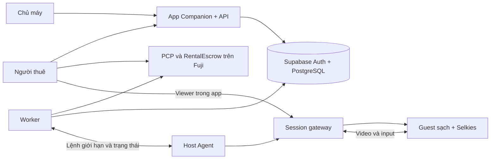

# Cloud PC Companion

**Chợ thuê PC từ xa trên Avalanche Fuji.** Chủ máy cho thuê PC theo khung giờ, người thuê trả bằng PCP (token thử) qua hợp đồng escrow, rồi dùng desktop từ xa ngay trong app Windows.

> **English TL;DR.** A peer-to-peer cloud-PC marketplace. Hosts rent out an idle Windows PC (a clean Selkies/Linux guest in WSL2); renters pay in a restricted test token (PCP) through an EIP-712-quoted escrow on **Avalanche Fuji (chain 43113)** and view the desktop inside a Tauri app. Everything is testnet-only. Judges can verify the contracts on the explorer (section 2), run 649 automated tests with no credentials (section 4A), or try the team's live demo (4B). Section 3 states plainly what was and was not verified.

**Trạng thái 20/11/2026.** Vòng thuê đầy đủ đã chạy thật trên Fuji (giữ máy → trả tiền → kích hoạt → xem desktop → kết thúc → chia tiền → máy sạch lại), nhưng **chỉ trên một máy** (người thuê và host cùng mạng, đi qua tunnel công khai). Chưa có người ở máy khác thuê thử. Chưa đo hiệu năng. Từ 20/11 chủ máy tự đăng ký và tự đăng máy (không còn admin duyệt), thông số máy do app tự đọc, và app có màn **Quản trị** thay cho script terminal. Xem [mục 3](#3-đã-kiểm-và-chưa-kiểm).

## Mục lục

1. [Sản phẩm](#1-sản-phẩm)
2. [Avalanche Fuji: địa chỉ và cách kiểm chứng](#2-avalanche-fuji-địa-chỉ-và-cách-kiểm-chứng)
3. [Đã kiểm và chưa kiểm](#3-đã-kiểm-và-chưa-kiểm)
4. [Cách chạy và chấm](#4-cách-chạy-và-chấm) (A: không cần tài khoản, B: demo của nhóm, C: tự dựng, D: màn Quản trị)
5. [Kiến trúc và cấu trúc repo](#5-kiến-trúc-và-cấu-trúc-repo)
6. [Bảo mật và giới hạn tin cậy](#6-bảo-mật-và-giới-hạn-tin-cậy)
7. [Tài liệu](#7-tài-liệu)

## 1. Sản phẩm

Một app Companion (Tauri 2 + React) có **hai chế độ trong một tài khoản**:

| Vai trò | Làm gì |
| --- | --- |
| **Người thuê** | Tìm máy, giữ máy, trả PCP, mở màn hình máy thuê, kết thúc, rút tiền hoàn về ví |
| **Chủ máy (host)** | Đăng máy (chỉ đặt tên và mô tả; CPU, GPU, RAM, ổ đĩa do app tự đọc từ máy, RAM/CPU chia sẻ cho khách do chủ máy chọn) và khung giờ, cài guest Linux trong WSL2 qua app, ghi danh thiết bị, bật/dừng nhận thuê, xem thu nhập |
| **Admin** (người tổ chức) | **Không còn là cổng** (từ 20/11/2026: host tự đăng ký, tự đăng máy sau khi quét đạt, tự ghi danh thiết bị). Chỉ là phanh khẩn cấp và người giám sát: dùng màn **Quản trị** trong app (mục "Quản trị" ở thanh bên, chỉ hiện với tài khoản có role admin, chế độ live) để xem host/máy/phiên/nhật ký, đình chỉ hoặc đăng lại máy và host, thu hồi thiết bị, xóa máy chưa có tiền/phiên. Thay cho `admin.mts` ở terminal |

**Luồng một phiên thuê**

1. Đăng nhập (Supabase Auth) và liên kết ví bằng chữ ký.
2. **Giữ máy:** DB giữ chỗ nguyên tử (một booking sống mỗi máy), server ký quote EIP-712.
3. **Trả tiền:** `approve` + `fund` PCP vào `RentalEscrow` trên Fuji. Server đối soát receipt trên chuỗi.
4. Worker bảo guest chuẩn bị máy sạch (container Selkies), rồi operator gọi `activate` trên chuỗi.
5. Host-agent cấp token xem một lần. App đổi token lấy phiên và hiện desktop Linux qua **session gateway** của host.
6. **Kết thúc:** `accept`, escrow chia tiền (phí nền tảng 10%, host nhận phần còn lại).
7. Thu hồi quyền xem, xoá và dựng lại container, xác minh sạch, rồi nhả máy.

Quy tắc tiền (theo hợp đồng): gói demo 15 phút. Kết thúc sớm sau khi kích hoạt vẫn trả cả gói. Hủy trước khi kích hoạt hoàn đủ, nhưng khoản hoàn được **ghi có trong escrow** và người thuê tự **Rút về ví** (pull-payment).

PCP là token thử, không có giá trị tiền, không mua bán hay rút ra VND. Avalanche AVAX chỉ để trả gas.

## 2. Avalanche Fuji: địa chỉ và cách kiểm chứng

Chain **Avalanche Fuji C-Chain, chainId 43113**. Deploy ngày 17/11/2026, khối deploy `61220946`. Dữ liệu dưới đây lấy từ manifest deploy (thư mục `contracts/deployments/` bị Git bỏ qua nên được ghi lại ở đây).

| Hợp đồng | Địa chỉ |
| --- | --- |
| **PCP** (ERC-20 hạn chế) | [`0x9040f984ea24661d8e57f140b4ce96dac6af513e`](https://testnet.snowtrace.io/address/0x9040f984ea24661d8e57f140b4ce96dac6af513e) |
| **RentalEscrow** | [`0x280697a0ba53aeea1b1cb3c15eb2c04461a243e1`](https://testnet.snowtrace.io/address/0x280697a0ba53aeea1b1cb3c15eb2c04461a243e1) |
| Giao dịch cấu hình escrow (`configureEscrowOnce`) | [`0x0f50f7fd…5a5280`](https://testnet.snowtrace.io/tx/0x0f50f7fdc48e8ed092de94d4cc31ac31a777ce28e8c59b46d66c429efd5a5280) |

Vai trò on-chain (địa chỉ công khai): admin `0x5ea46bed5249ea11edaa4bbc389854870a76d6a2`, operator `0x384D38BD2d656B714460BAA0180C11d54af10D46`, arbitrator `0xfE2852313c41875FFB59f067565F0911AF7b4cEc`, quote signer `0xD2D0e33b7bcd8a190B9E4afC925cdc4b05560D24`, issuer `0x4BFfeB1Cb1B9FB25Ae9e0a4747D33Bc319684012`, treasury `0x8f006D933EF8670569fBF8E6398446eF671b9ace`.

Cấu hình: `feeBps = 1000` (10%), `durationSeconds = 900`, `graceSeconds = 600`, `arbitrationSeconds = 86400`. Biên dịch bằng solc 0.8.28, optimizer 200 runs, `viaIR`. Domain EIP-712: `CloudPCRentalEscrow` v1.

**Cách kiểm chứng:** mở trang địa chỉ RentalEscrow ở trên, xem danh sách giao dịch và log (`Funded`, `Activated`, sự kiện accept/settle, rút tiền). Mã nguồn ở `contracts/contracts/PCP.sol` và `RentalEscrow.sol`, ABI ở `packages/shared/src/abi/`. README không liệt kê sẵn mã giao dịch của từng lần thuê thử, vì trang giao dịch của escrow luôn là nguồn đúng nhất.

**Thiết kế hợp đồng**
- **PCP**: ERC-20 18 decimals, trần 1.000.000, **chỉ chuyển qua escrow** (không chuyển P2P, không permit/burn/mint tự do). Vòi: 1.000 PCP một lần mỗi ví. `configureEscrowOnce` chỉ gọi được một lần.
- **RentalEscrow**: quote EIP-712 16 trường, `fund` kéo token trong cùng giao dịch và kiểm số nhận chính xác (chặn fee-on-transfer), các hàm cancel / refund / activate / accept / dispute / claim / resolve / `withdrawPCP`. Pull-payment, `pause` chỉ chặn `fund` và `activate` (tiền vẫn thoát được), **không có sweep**.
- Kiểm thử hợp đồng: 52 test Hardhat (sai quote/asset/domain/thời gian, biên thời gian đúng một giây, race cancel↔activate và dispute↔claim, làm tròn phí, reentrancy, fee-on-transfer). Chưa audit độc lập, chưa fuzz/invariant.

## 3. Đã kiểm và chưa kiểm

Mục tiêu của bản này là **tìm chỗ hỏng**, không phải khẳng định mọi thứ đã chạy.

| Phần | Trạng thái |
| --- | --- |
| Đăng ký/đăng nhập, danh mục máy, giữ máy (Supabase dev) | Chạy thật |
| Ví thử trong app, vòi PCP và gas trên Fuji | Chạy thật bằng script dùng chính mã của app. **Chưa có người ngoài thử bằng app** |
| Thanh toán, kích hoạt, kết thúc, chia tiền trên escrow Fuji | Chạy thật trên **một máy**: 20/20 bước đạt qua tunnel công khai (18/11), số tiền và phí 10% khớp chính xác (so với giá máy tính bằng bigint) |
| Xem màn hình qua gateway của host | Trình duyệt thật đổi token một lần (HTTP 200), WebSocket nhận luồng hình 1280×720; không token bị từ chối (401). **Chưa thử từ máy khác mạng, chưa đo độ trễ/FPS** |
| Host WSL2 + Docker + image Selkies | Chạy thật trên máy phát triển: agent ghi danh, nhận lệnh, chạy trọn một phiên. Phần host được chạy bằng chuỗi lệnh tương đương `host.rs`, **không bấm qua giao diện app** |
| **Chưa kiểm** | Hai máy khác mạng (**đã bỏ qua theo quyết định của chủ dự án**); viewer nhúng trong WebView2 (chuột, bàn phím, âm thanh, toàn màn hình); các màn thiết lập host trong app; nút **Rút về ví**; hộp xác nhận kết nối trong app; bộ cài trên máy khác (chưa ký số: SmartScreen cảnh báo, **Smart App Control chặn hẳn**); GPU/NVENC trong WSL2; **việc app tự đọc thông số máy (CPU, GPU, VRAM, RAM chia sẻ) trong app Windows thật** (mới viết 20/11, mới kiểm bằng dữ liệu giả và test); chỉ đọc được **tên GPU NVIDIA** (GPU AMD/Intel hiện ghi "chưa đọc được tên"); màn Quản trị mới kiểm trong trình duyệt với dữ liệu thật, chưa kiểm trong app đã cài; script `scripts/browser-check-live.mjs` **còn đỏ** vì còn so khớp lời giao diện cũ (không thuộc bộ `npm test`) |
| **Hiệu năng** | **Chưa đo, không có tuyên bố nào** |
| Còn mô phỏng hoặc chưa làm | Workspace dùng thư mục cục bộ (`LocalFsStore`), chưa S3; thông báo, hỗ trợ, trọng tài, thu nhập chi tiết; AI tư vấn và host bond chỉ có thiết kế; audit hợp đồng; deploy web công khai |

Chi tiết và nhật ký: [PROGRESS](docs/PROGRESS.md), [HOST_WINDOWS_WSL](docs/HOST_WINDOWS_WSL.md), [DEMO_RUNBOOK](docs/DEMO_RUNBOOK.md), [TESTER_GUIDE](docs/TESTER_GUIDE.md) mục 0.

## 4. Cách chạy và chấm

Chọn mức theo thứ bạn có:

| Mức | Cần gì | Thấy gì |
| --- | --- | --- |
| **A** | Chỉ Node.js, không tài khoản nào | Giao diện app với dữ liệu mẫu có nhãn; 649 test tự động |
| **B** | Bộ cài + liên kết kết nối do nhóm cấp | Vòng thuê thật trên Fuji với máy của nhóm |
| **C** | Hạ tầng riêng (Supabase, AVAX Fuji, Windows 11 + WSL2) | Tự dựng toàn bộ hệ thống |

### A. Không cần tài khoản (khuyến nghị để chấm mã nguồn)

Yêu cầu: **Node.js ≥ 20.9** (đã chạy với Node 26, npm 11), Git. Đã chạy trên **Windows 11**; macOS và Linux chưa được thử.

```bash
git clone https://github.com/nguyenkhoi152/cloud-pc-marketplace.git
cd cloud-pc-marketplace
npm install
```

**Xem giao diện (chế độ preview, toàn bộ dữ liệu là mẫu có nhãn):**

```bash
npm run dev:desktop        # mở http://127.0.0.1:5174
```

Không có file `.env`, app tự vào chế độ preview. Mở `/#/welcome`, chọn "Vào nhanh với tài khoản demo", rồi chọn chế độ Thuê máy hoặc Cho thuê máy. Nút **Demo** ở thanh trên đổi kịch bản (thành công, lỗi dịch vụ, mất mạng, host chưa duyệt, lỗi cleanup…). Ở preview mọi hành động tiền và remote chỉ là mô phỏng.

**Chạy toàn bộ test** (đã chạy hết **trên một bản clone sạch từ GitHub**, Windows 11, ngày 20/11/2026: `npm ci`, `npm run typecheck`, `npm run lint`, `npm test` đều exit 0, tổng 649 test):

```bash
npm test
```

| Workspace | Test | Kiểm gì |
| --- | --- | --- |
| `packages/shared` | 28 | Schema, tiền PCP (chuỗi thập phân, bigint, không dùng number), lọc máy, cấu hình |
| `db` | 87 | Migration, RLS, grants, khoá đồng thời, tự đăng máy, màn Quản trị. Chạy trên PGlite **và PostgreSQL 18 thật** cục bộ, hai connection |
| `contracts` | 52 | PCP và RentalEscrow trên mạng Hardhat |
| `desktop` | 323 | Logic domain, lớp API live (client giả có nhãn), render từng màn, bàn phím, liên kết kết nối, thẻ máy, màn Giới thiệu (đối chiếu lời với cấu hình hợp đồng trên Fuji), đọc thông số máy |
| `host-agent` | 52 | Agent, enrollment, session gateway |
| `server` | 107 | API, worker, đối soát chuỗi; gồm một bài tích hợp E2E cục bộ (HTTP thật + worker + agent + gateway + Postgres thật) |

Lần chạy đầu cần Internet để Hardhat tải trình biên dịch solc 0.8.28; PostgreSQL 18 cho test `db` đi kèm devDependency `embedded-postgres` nên đã có sau `npm install`. Bài E2E dùng chuỗi, guest/Selkies và operator **giả có nhãn**, không chạm Fuji.

Lệnh riêng lẻ: `npm run typecheck`, `npm run lint`, `npm run build:desktop`, `npm test -w @cpm/contracts`, `npm run compile -w @cpm/contracts`. Test Rust của lớp native (cần Rust): **dựng agent trước**, vì `host-agent/dist/` không nằm trong Git mà `host.rs` nhúng tệp từ đó lúc biên dịch: `npm run bundle:agent -w @cpm/desktop`, rồi `cargo test --release --lib` trong `desktop/src-tauri`.

**Biên dịch và deploy contract cục bộ (không cần ví, không tốn gì):** `cd contracts && npx hardhat run scripts/deploy.ts` deploy lên mạng mô phỏng trong tiến trình và ghi manifest cục bộ.

### B. Dùng thử demo đang chạy của nhóm

Máy chủ API, worker và máy cho thuê **chạy trên PC của nhóm**, nên chỉ dùng được khi nhóm đang bật. Hãy hẹn giờ với nhóm. Địa chỉ tunnel Cloudflare **đổi mỗi lần nhóm khởi động lại**.

<!-- TODO(chủ repo): thêm liên kết video demo, slide, bộ cài (kèm SHA256SUMS.txt) và liên hệ đặt lịch thử. -->

1. Cài `Cloud PC Companion_0.2.0_x64-setup.exe` (Windows 11): tải ở mục **Releases** của repo này, kèm `SHA256SUMS.txt`; hoặc nhóm gửi trực tiếp. Bộ cài **chưa ký số** (`Get-AuthenticodeSignature` báo `NotSigned`), nên tuỳ máy bạn sẽ gặp một trong hai:
   - **SmartScreen** ("Windows protected your PC"): đối chiếu SHA-256 trong `SHA256SUMS.txt` bằng `Get-FileHash <tệp> -Algorithm SHA256`, rồi chọn *More info → Run anyway*.
   - **Smart App Control** (thường bật sẵn trên máy Windows 11 mới cài): **chặn hẳn, không có nút bỏ qua và không cho phép riêng từng app**. Chỉ có cách tắt trong *Windows Security → App & browser control → Smart App Control settings → Off*. Trên bản Windows cũ, đã tắt thì **không bật lại được nếu không cài lại Windows** (bản mới hơn có thể bật lại). Nếu không muốn tắt, hãy dùng máy khác, xem mức A hoặc video.
2. Bấm **liên kết kết nối** nhóm gửi (`https://….trycloudflare.com/api/connect`), chọn *Mở*, rồi **Kết nối** ở hộp xác nhận. Nếu không được, dán địa chỉ vào **Cài đặt → Kết nối máy chủ**. Chỉ dán địa chỉ từ người bạn tin: app gửi phiên đăng nhập của bạn tới đó.
3. **Đăng ký tài khoản mới** (dùng email và mật khẩu không trùng tài khoản quan trọng). Không dùng tài khoản của host: hệ thống chặn host thuê máy của chính mình.
4. **Ví → Liên kết ví → Nhận PCP và AVAX.** App tự sinh ví thử (khoá nằm trong app; xoá dữ liệu app là mất ví, không sao vì là testnet).
5. **Khám phá → chọn máy → Giữ máy → Trả tiền.** Chờ các bước chuẩn bị (thường 1,5 đến 3 phút), rồi **Mở màn hình**.
6. **Kết thúc phiên.** Dữ liệu trong máy thuê bị xoá khi phiên kết thúc.
7. Thử hoàn tiền: giữ máy, trả tiền rồi hủy trước khi kích hoạt. Khoản hoàn nằm ở **Ví → PCP đang chờ rút → Rút về ví** (tốn một ít gas testnet).

Nếu bỏ dở giữa chừng, máy bị giữ tới khoảng 12 phút rồi tự nhả; đừng bấm giữ máy liên tục. Khi báo lỗi, ghi bước đang làm, thông báo app hiện và cấu hình máy bạn. Che mã kết nối và địa chỉ ví nếu không muốn lộ.

### C. Tự dựng toàn bộ hệ thống (nâng cao, không bắt buộc để chấm)

> **Lưu ý trung thực:** chuỗi bước dưới đây suy ra từ đầu vào mà từng script yêu cầu và từ lịch sử dựng của nhóm. Nhóm **chưa dựng lại từ một máy trống** để thử cả chuỗi. Nếu một bước lỗi, các runbook ở mục 7 là nguồn chi tiết hơn.

**Điều kiện:** Windows 11 (Home/Pro) bật ảo hoá, khuyến nghị ≥ 16 GB RAM và ≥ 40 GB trống; Node ≥ 20.9; **Rust (rustup, MSVC) và Visual Studio Build Tools 2022** để build app Tauri; PowerShell 5.1+; một project **Supabase dev của riêng bạn**; AVAX testnet từ faucet Avalanche. Các script demo **gán cứng thư mục `C:\cpm-demo`** (khoá, nhật ký, bản phát hành) và chỉ hỗ trợ Windows + WSL2.

1. **Cài:** `npm install`.
2. **Supabase:** tạo project dev, bật Email provider và **tắt xác nhận email** (smoke test cần). Áp **11 migration** trong `supabase/migrations/` theo thứ tự tên file (`scripts\supabase-migrations.ps1 -Bundle <tệp>` tạo file gộp, dán từng file vào SQL Editor; migration thứ 10 `20261120000001_self_service_listing.sql` bỏ bước admin duyệt, thứ 11 `20261120000002_admin_dashboard_availability.sql` thêm trạng thái online thật và hàm xóa máy cho màn Quản trị), rồi chạy `supabase/verify/post_migration_checks.sql` và đảm bảo mọi dòng 1–16 là `true`. Chi tiết: [SUPABASE_DEV_SETUP](docs/SUPABASE_DEV_SETUP.md). Không dùng `supabase db push` hoặc reset trên project có dữ liệu.
3. **Môi trường:** `desktop/.env.example` → `desktop/.env.local` (`VITE_APP_MODE=live`, URL, **key publishable**) và `web/.env.example` → `web/.env.local` (biến server; mỗi dòng chỉ `TÊN=GIÁ_TRỊ`, không chú thích cùng dòng). Kiểm bằng `npm run check:env` (không in giá trị). Mọi biến `VITE_*` bị nhúng vào app: **không bao giờ** đặt service-role key, mật khẩu DB hay khoá ký ở đó.
4. **Tài khoản thử và admin:** `npm run smoke:supabase` tạo bốn tài khoản thử (admin, host, hai renter) vào `desktop/.env.smoke.local` (Git bỏ qua) và máy `smoke-*`. Test **in ra các câu SQL** cần chạy trong SQL Editor (cấp role admin, gắn ví thử). Chạy chúng rồi chạy lại cho tới khi xanh. Admin chỉ được cấp bằng SQL Editor, không có đường nào từ client.
5. **Fuji:** `node scripts/fuji/fuji.mjs gen` (khoá vai trò ở `C:\cpm-demo\fuji\keys.json`, ngoài repo, không in khoá riêng) → nạp AVAX testnet vào địa chỉ **issuer** vừa in → `node scripts/fuji/fuji.mjs fund --each 0.03 --keep 0.2 --dry` (bỏ `--dry` để chuyển thật) → `node scripts/fuji/fuji.mjs deploy` (ghi `server.env`) → `node scripts/fuji/verify.mjs` (chỉ đọc, đối chiếu manifest, on-chain và `server.env`). Chi phí deploy thực đo được khoảng 0,007 AVAX. [FUJI_RUNBOOK](docs/FUJI_RUNBOOK.md).
6. **Công cụ:** `powershell -File scripts\public\get-cloudflared.ps1` (tải bản ghim và kiểm SHA-256), `npm run bundle -w @cpm/host-agent`.
7. **Trạng thái demo:** với API đang chạy (`npm run dev -w web` ở cửa sổ khác), chạy `npx tsx scripts/vm/session-setup.mts <thư-mục-agent> C:\cpm-demo\state.json`. Script chọn máy đã duyệt và tạo tài khoản người thuê demo.
8. **WSL2 (quản trị, một lần):** `wsl --install --no-distribution`, khởi động lại, rồi `wsl --install -d Ubuntu-24.04` và đặt user Linux. Dùng bản này **riêng cho việc cho thuê**. [HOST_WINDOWS_WSL](docs/HOST_WINDOWS_WSL.md).
9. **Bộ cài:** `powershell -File scripts\vm\build-demo-app.ps1 -Profile tester` ra `C:\cpm-demo\release\*-setup.exe` cùng `SHA256SUMS.txt`. Cài app, đăng nhập bằng tài khoản host (ở bước 4), vào **Cho thuê máy → Thiết lập & chạy máy** và làm tới khi agent được cài xong (cài Docker, Node và tải image Selkies khoảng 8 GB). **Dừng ở đó, không bấm "Bắt đầu nhận thuê"**: `start-all.ps1` ở bước sau sẽ ghi danh và chạy agent.
10. **Bật cả hệ thống bằng một lệnh** (3–5 phút vì build web bản production; giữ máy bật và cửa sổ mở):
    ```powershell
    powershell -File scripts\public\start-all.ps1
    ```
    Script dựng API production, worker, proxy chỉ cho `/api/*`, tunnel Cloudflare, cam kết giờ của host, mã ghi danh mới; rồi bật tunnel gateway, cấu hình và ghi danh agent trong WSL2. Cuối cùng in **LIÊN KẾT KẾT NỐI** (`https://….trycloudflare.com/api/connect`, gửi cho người thử và bấm trong trình duyệt) và **MÃ KẾT NỐI** (địa chỉ gốc, chỉ để dán thủ công vào Cài đặt; mở địa chỉ gốc trong trình duyệt báo 404 là bình thường). Khi script này chạy agent, **không bấm "Bắt đầu nhận thuê"** trong app (xung đột cổng 18095). Muốn thử luồng host trong app: thêm `-ServerOnly`.
11. **Không cần duyệt host/máy hay cấp mã ghi danh nữa** (host tự làm trong app: đăng ký → tạo máy → **Quét & đăng máy** → **Ghi danh máy này**). Admin chỉ còn để giám sát và đình chỉ khi có sự cố, làm trong màn **Quản trị** của app (đăng nhập bằng tài khoản có role admin; cấp role bằng SQL, xem [ADMIN_DEV_FIX](docs/ADMIN_DEV_FIX.md)). Script `admin.mts` (`find`, `suspend-machine`, `approve-host`, `approve-machine`, `enroll`) vẫn chạy được cho trường hợp cần làm tay.
12. Dùng app theo các bước 2–7 của mức B với **tài khoản người thuê khác tài khoản host**.
13. **Tắt:** `powershell -File scripts\vm\stop-demo.ps1 -KeepVm`.

Kiểm phần chuỗi của luồng thuê bằng script (tạo một tài khoản tạm trên Supabase dev và gửi giao dịch thật trên Fuji): `npx tsx scripts/public/fuji-rental-check.mts <địa chỉ API> --full`.

Nếu mạng chặn UDP/QUIC ra ngoài, `cloudflared` không có địa chỉ; hai script đã ép `--protocol http2` (TCP), chậm hơn một chút.

### D. Màn Quản trị (admin)

Chỉ có ở **bản thật** (đã kết nối Supabase), với tài khoản có dòng `admin` trong bảng `user_roles`. Bản xem trước (mức A) **không có** màn này. Không có mật khẩu admin nào được công khai trong repo; muốn vào bằng tài khoản của bạn:

1. Đăng ký một tài khoản trong app rồi lấy mã người dùng (`user_id`): Supabase → Authentication → Users, hoặc `npx tsx scripts/public/admin.mts find <tên hiển thị>` (chỉ đọc).
2. Trong Supabase → SQL Editor, chạy (thay `<user_id>`):
   ```sql
   insert into public.user_roles (user_id, role) values ('<user_id>', 'admin') on conflict do nothing;
   ```
3. Đăng xuất rồi đăng nhập lại: menu bên trái có mục **Quản trị** (hoặc mở `/#/admin`).

Màn có sáu tab (Tổng quan, Máy, Host, Phiên thuê, Người dùng, Nhật ký) và cho đình chỉ hoặc khôi phục host và máy, xóa máy, thu hồi thiết bị. Cờ admin ở giao diện chỉ để ẩn hiện menu: quyền thật do database kiểm (RLS và hàm chỉ dành admin), người khác gọi thẳng cũng bị từ chối. Chi tiết: [SECURITY](docs/SECURITY.md) mục 12.

## 5. Kiến trúc và cấu trúc repo



**Hai đường riêng.** *Control plane* quản lý đăng nhập, booking, tiền, quyền. *Streaming plane* truyền hình và input giữa app và guest qua gateway; Selkies không mở thẳng cho người thuê. Blockchain không xử lý khung hình, tệp hay dữ liệu cá nhân.

**Nguồn sự thật:** tiền do hợp đồng quyết định; danh tính và giữ chỗ do DB; trạng thái guest do bằng chứng từ agent (trạng thái không rõ **không** bị coi là thành công); máy chỉ nhả sau khi tiền ở trạng thái cuối và cleanup đạt.

| Thư mục | Nội dung |
| --- | --- |
| `desktop/` | App Companion (React 19, Vite, Tailwind 4); `desktop/src-tauri/` là vỏ native Rust (Tauri 2, 10 lệnh native cố định cho chế độ Cho thuê) |
| `server/` | API core, worker (lease, fencing, đối soát chuỗi), workspace broker |
| `web/` | Next.js: route `/api/[...path]` (adapter mỏng gọi `server/`) và trang giới thiệu |
| `host-agent/` | Agent chạy trong guest Linux, session gateway (token một lần, thu hồi, watchdog), script guest |
| `contracts/` | `PCP.sol`, `RentalEscrow.sol`, test Hardhat 3 + viem, script deploy |
| `db/` | Test migration/RLS/đồng thời (PGlite và PostgreSQL thật) |
| `supabase/` | 11 migration, script kiểm sau áp dụng |
| `packages/shared/` | Schema zod, tiền PCP, lọc máy, ABI xuất ra `src/abi/` |
| `scripts/` | `fuji/` (khoá, nạp, deploy, kiểm), `public/` (tunnel, admin, `start-all.ps1`), `vm/` (dựng demo, build bộ cài, e2e) |
| `docs/`, `specs/` | Hồ sơ đặc tả, runbook, nhật ký tiến độ (Spec Kit) |
| `design-preview/` | Bản mẫu giao diện tĩnh, chỉ để tham khảo |

Stack chính: TypeScript 6, Node, React 19, Vite 8, Tailwind 4, Tauri 2, Next 16, Supabase (Postgres + RLS), Solidity 0.8.28 + OpenZeppelin 5, Hardhat 3, viem, Selkies, Cloudflare Tunnel.

## 6. Bảo mật và giới hạn tin cậy

- **Host là bên được tin.** Chủ máy là quản trị viên của PC nên **không thể** bảo vệ dữ liệu của khách khỏi chính mình; WSL2 và Docker không phải chứng nhận cô lập. Chỉ cho thuê giữa các bên tin nhau, đừng đặt dữ liệu quan trọng trong máy thuê.
- **Agent chỉ gọi ra ngoài**, không mở cổng vào từ Internet, không có đường chạy lệnh tuỳ ý: 10 lệnh native cố định, tham số kiểm dạng ở cả Rust và script guest, cấu hình và mã ghi danh đi qua stdin.
- **Gateway:** nghe loopback trong guest; token xem dùng một lần, đổi lấy phiên; không token trả 401; thu hồi khi phiên kết thúc.
- **Dữ liệu:** RLS mặc định từ chối; client không ghi được booking, outbox, role; hàm chỉ dành server chỉ cấp cho `service_role`. Test quét mọi hàm trong schema `public`.
- **Cấu hình fail-closed:** thiếu hoặc sai cấu hình thì app báo lỗi, API trả 503 và nêu tên biến, không rơi về dữ liệu mẫu. Server từ chối khoá Hardhat công khai đi kèm RPC từ xa; app từ chối key `sb_secret_…` trong `VITE_*`.
- **Bản thử công khai:** proxy chỉ chuyển `/api/*` và chặn `/api/admin/*` từ Internet. Cloudflare Quick Tunnel là dịch vụ không cam kết và **là bên trung gian có thể thấy lưu lượng** (hình ảnh và thao tác của phiên). Máy chủ chạy trên PC của nhóm: tắt máy là mọi thứ dừng. Xem [SECURITY](docs/SECURITY.md).
- **Chưa audit độc lập**, chưa có ký số cho bộ cài.
- File `.env*` thật nằm ngoài Git (chỉ `*.example` được commit). Các khoá `0x…` xuất hiện trong test và script demo là **khoá công khai của Hardhat**, vô giá trị với chuỗi thật.

## 7. Tài liệu

Hướng dẫn vận hành:

| Tài liệu | Dùng để |
| --- | --- |
| [TESTER_GUIDE](docs/TESTER_GUIDE.md) | Hướng dẫn thử cho người ngoài (người thuê, chủ máy, người tổ chức) |
| [DEMO_RUNBOOK](docs/DEMO_RUNBOOK.md) | Chạy gì, thật hay giả, smoke test và dữ liệu chúng ghi |
| [SUPABASE_DEV_SETUP](docs/SUPABASE_DEV_SETUP.md) | Dựng project Supabase dev, áp migration, tạo admin |
| [FUJI_RUNBOOK](docs/FUJI_RUNBOOK.md) | Khoá, nạp AVAX, deploy, kiểm |
| [HOST_WINDOWS_WSL](docs/HOST_WINDOWS_WSL.md) | Luồng cho thuê trên Windows, cài WSL2, bảng bằng chứng |
| [desktop/README](desktop/README.md) | App Companion, build Tauri |

Đặc tả và thiết kế:

| Tài liệu | Nội dung |
| --- | --- |
| [MVP](docs/MVP.md), [PRODUCT](docs/PRODUCT.md) | Phạm vi, khách hàng, mô hình kinh doanh |
| [ARCHITECTURE](docs/ARCHITECTURE.md), [DATA_MODEL](docs/DATA_MODEL.md) | Thành phần, schema, đồng thời, jobs, endpoint |
| [CONTRACT_SPEC](docs/CONTRACT_SPEC.md), [POINTS_AND_PAYMENTS](docs/POINTS_AND_PAYMENTS.md) | PCP, escrow, quote, hoàn tiền, tranh chấp |
| [REMOTE_ACCESS](docs/REMOTE_ACCESS.md), [CLOUD_WORKSPACES](docs/CLOUD_WORKSPACES.md) | Agent, gateway, thu hồi; workspace theo project |
| [SECURITY](docs/SECURITY.md), [TEST_PLAN](docs/TEST_PLAN.md) | Ranh giới tin cậy; kế hoạch và bằng chứng kiểm thử |
| [MARKETPLACE_POLICIES_DRAFT](docs/MARKETPLACE_POLICIES_DRAFT.md), [PRIVACY_POLICY_DRAFT](docs/PRIVACY_POLICY_DRAFT.md) | Chính sách và quyền riêng tư của bản demo |
| [PROGRESS](docs/PROGRESS.md) | Nhật ký tiến độ và bằng chứng theo ngày |

Dành cho người phát triển và AI agent: [START_HERE](START_HERE.md), [AGENTS](AGENTS.md), [Quyền và mặc định](docs/APPROVAL.md), [Lộ trình](docs/DEVELOPMENT_GUIDE.md), [Workflow](docs/AGENT_WORKFLOW.md), [Nguồn tham khảo](docs/SOURCES.md). `docs/archive/` và `deliverables/` chỉ giữ lịch sử, không có hiệu lực đặc tả.
